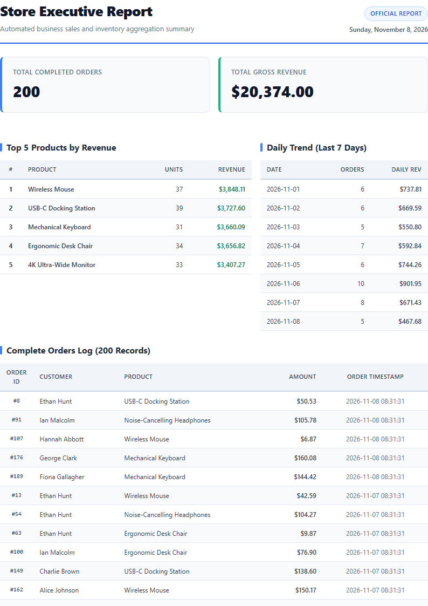

# Automated PDF Sales Report Generator

An automated data-to-document backend pipeline built with **Node.js 22+**, **Express**, **SQLite** (via the zero-dependency built-in `node:sqlite` module), and **Playwright** headless Chromium.

It extracts order records using SQL aggregations, renders a multi-page executive document with print-safe CSS (avoiding broken rows and repeating table headers on every page), stores the artifact on disk, and serves it via an idempotent API link.

---

## Architecture: Store and Link Pipeline

```
[ SQLite report.db ] ──(SQL Aggregations)──> [ Template Engine ] ──(Playwright Chromium)──> [ reports/<id>.pdf ]
                                                                                                    │
Client Request ─── POST /reports ─────────────────────────────────────────────────────────────┘
      │
      ├──> Returns JSON: { "id": 1, "file": "/reports/1/file" } (Megabytes stay on disk)
      └──> Client downloads: GET /reports/1/file ──> Streamed PDF artifact
```

---

## Dataset Selection

**Chosen Option:** **Option A — The Little Shop**
- **Table:** `orders` inside SQLite `report.db`
- **Schema:**
  - `id`: `INTEGER PRIMARY KEY AUTOINCREMENT`
  - `customer`: `TEXT NOT NULL`
  - `product`: `TEXT NOT NULL` (6 products: Mechanical Keyboard, Wireless Mouse, USB-C Docking Station, Noise-Cancelling Headphones, 4K Ultra-Wide Monitor, Ergonomic Desk Chair)
  - `amount`: `REAL NOT NULL` (Randomized between $5.00 and $200.00)
  - `created_at`: `TEXT NOT NULL` (Distributed over the last 30 days)
- **Seed Guarantees:** The seed script executes `DELETE FROM orders;` before insertion, making it completely idempotent. Seeding twice yields exactly 200 clean rows.

---

## Quickstart & How to Run

### Prerequisites
- Node.js 22.0.0 or higher
- npm 10+
- Headless Chromium (installed automatically via Playwright)

### 1. Installation
```bash
npm install
npx playwright install chromium
```

### 2. Seed Database
```bash
npm run seed
```
*Expected output: `Seeded orders count: 200` (even when executed multiple times).*

### 3. Verify Aggregation Query Output
```bash
npm run test-report
```

### 4. Start Server
```bash
npm start
```
*Server starts on `http://localhost:8000` (or `PORT` environment variable).*

---

## SQL Aggregation Queries

The four reporting aggregations executed against SQLite in `src/report-data.js`:

```sql
-- 1. Total Number of Orders & 2. Total Gross Revenue
SELECT 
  COUNT(*) AS total_orders,
  COALESCE(ROUND(SUM(amount), 2), 0) AS total_revenue
FROM orders;

-- 3. Top 5 Products by Revenue
SELECT 
  product,
  ROUND(SUM(amount), 2) AS revenue,
  COUNT(*) AS order_count
FROM orders
GROUP BY product
ORDER BY revenue DESC
LIMIT 5;

-- 4. Orders Per Day for the Last 7 Days (Parameterized)
SELECT 
  date(created_at) AS date,
  COUNT(*) AS order_count,
  ROUND(SUM(amount), 2) AS revenue
FROM orders
WHERE date(created_at) >= date('now', '-' || ? || ' days')
GROUP BY date(created_at)
ORDER BY date ASC;

-- Full Order List (Feed for the long multi-page table)
SELECT id, customer, product, amount, created_at
FROM orders
ORDER BY created_at DESC;
```

---

## API Endpoints & Verification Proof

| Method | Endpoint | Description |
|---|---|---|
| `GET` | `/health` | Health check (`{ "status": "ok" }`) |
| `POST` | `/reports` | Generate report (Idempotent: returns existing today or creates new; accepts `{ "force": true, "days": 7 }`) |
| `GET` | `/reports` | Control panel: list all generated reports with links |
| `GET` | `/reports/:id` | Get report metadata and download link |
| `GET` | `/reports/:id/file` | Download PDF artifact (`res.sendFile`) |

### Terminal Proof: POST → Download Pipeline

```bash
# 1. Health check
curl -i http://localhost:8000/health
# HTTP/1.1 200 OK -> {"status":"ok"}

# 2. First report generation request (runs pipeline: query -> render -> store)
curl -i -X POST http://localhost:8000/reports
# HTTP/1.1 201 Created
# {"id":1,"file":"/reports/1/file"}

# 3. Retrieve report metadata
curl -i http://localhost:8000/reports/1
# HTTP/1.1 200 OK
# {"id":1,"path":"reports\\1.pdf","created_at":"2026-11-08 09:39:02","file":"/reports/1/file"}

# 4. Download PDF artifact by link (store and link pattern)
curl -s -o my-report.pdf http://localhost:8000/reports/1/file
# Result: Downloaded 101,611-byte valid multi-page PDF document!
```

### Stage 5 Proof: Double-Click Idempotency

```bash
# Request #1:
curl -i -X POST http://localhost:8000/reports
# -> HTTP/1.1 201 Created, {"id":1,"file":"/reports/1/file"}

# Request #2 (Immediately fired duplicate):
curl -i -X POST http://localhost:8000/reports
# -> HTTP/1.1 200 OK, {"id":1,"file":"/reports/1/file"}
# Verified: No duplicate PDF generated in reports/

# Request #3 (Force fresh generation):
curl -i -H "Content-Type: application/json" -d '{"force": true}' -X POST http://localhost:8000/reports
# -> HTTP/1.1 201 Created, {"id":2,"file":"/reports/2/file"}
```

---

## Required Analysis & Reflections

### Stage 4: "Feel the Wait"
> **At what point would you move this work out of the request?**
>
> I would move PDF generation out of the request into an asynchronous background job the moment request latency exceeds 500ms, when document size or concurrent user traffic risks exhausting Node's event loop or available memory with multiple Chromium instances, or whenever timeouts from reverse proxies (such as Nginx, Cloudflare, or AWS ALB 30-second gateway timeouts) become a failure mode.

### Stage 5: Idempotency & Financial Impact
> **What does your check protect against?**
>
> The idempotency check protects against duplicate report generation triggers caused by user double-clicks, automated retries from network glitches, or duplicate webhook dispatches, preventing wasted server compute and disk bloat.
>
> **Real-world example where a missing check costs money:**
>
> In transactional billing or automated invoice generation, a missing idempotency check can cause a customer's credit card to be double-charged or trigger duplicate automated billing emails with separate invoice IDs, leading to immediate payment dispute chargeback fees (\$15–\$25 per dispute) and severe reputational damage.

---

## Generated Report Preview

The generated document spans 9 pages, featuring KPI overview cards, side-by-side metric tables, and a full 200-order audit trail with print CSS (`tr { break-inside: avoid; }` and `thead { display: table-header-group; }`) ensuring no split rows and repeated table headers on every page:



---

## Extras Implemented

1. **Executive Styling & Print CSS**:
   - Modern indigo/slate typography, executive KPI status boxes, and responsive side-by-side data tables.
   - Repeating header row on every printed page via `thead { display: table-header-group }`.
   - Page break protection on all rows via `tr { break-inside: avoid; page-break-inside: avoid; }`.
   - Running footer with dynamic page numbers (`Page X of Y`).
2. **Parameterized Reports**:
   - `POST /reports` accepts `{ "days": 14 }` to dynamically recalculate trends over customizable time horizons.
3. **Control Panel Endpoint**:
   - `GET /reports` returns all historically generated reports and their direct download links.
4. **Professional File Downloads**:
   - `GET /reports/:id/file` sends `Content-Disposition: inline; filename="sales-report-<id>.pdf"`.
5. **The Big-Table Experiment (5,000 Rows)**:
   - Seeded 5,000 orders to benchmark the pipeline under load.
   - **Measurements:**
     - SQL Aggregation Query time: **46ms**
     - Playwright PDF Rendering time: **2,781ms**
     - Total time: **2,827ms**
   - **Takeaway:** While SQLite handles 5,000 rows in under 50ms, the headless browser DOM layout and rasterization scale linearly with page count, confirming that rendering documents with thousands of rows inside a synchronous HTTP request will quickly degrade user experience and requires offloading to a background queue.

---

## Bonus Stage 7: The AI Rematch

### 1. Specification Prompt Used
```text
Build a Node.js (Express + SQLite via node:sqlite + Playwright Chromium) backend service implementing an automated report pipeline:
1. Seed Database: A SQLite database 'report.db' with an 'orders' table (id, customer, product, amount, created_at). Write a seed script inserting 200 realistic orders spread over the last 30 days. The script must clear old data first so re-running leaves exactly 200 rows.
2. Aggregation Queries: Write queries for total order count, total gross revenue, top 5 products by revenue, and daily orders for the last 7 days.
3. PDF Generation: Build an HTML report with KPI totals, top 5 table, daily trend table, and a 200-order table. Render using Playwright headless Chromium with print CSS preventing split rows (tr break-inside avoid) and repeating table headers on every page.
4. API Endpoints:
   - GET /health -> { "status": "ok" }
   - POST /reports -> generates PDF into reports/<id>.pdf, records metadata in reports table (id, path, created_at), returns 201 with { id, file: "/reports/<id>/file" }.
   - Idempotency: If generated today, return 200 with existing id/link unless { force: true } is provided.
   - GET /reports/:id -> returns metadata and file link, or 404.
   - GET /reports/:id/file -> streams PDF from disk.
```

### 2. Side-by-Side Review & Differences

| Dimension | Hand-Built Implementation (`src/`) | AI-Generated Implementation (`ai-version/`) |
|---|---|---|
| **Architecture** | Cleanly modularized (`db.js`, `seed.js`, `report-data.js`, `renderer.js`, `server.js`) | Monolithic single file (`ai-version/server.js`) |
| **Print CSS & Page Breaks** | Included `thead { display: table-header-group; }`, `tr { break-inside: avoid; }`, and Playwright margin + footer templates | Only included `tr { break-inside: avoid }`; omitted `thead` display styling, header/footer templates, and page margins |
| **Background Rendering** | Set `printBackground: true` so badges, KPI cards, and alternating rows print correctly | Omitted `printBackground: true`, stripping colors and backgrounds when printed by Chromium |
| **XSS & HTML Escaping** | Sanitized all customer and product strings via `escapeHtml()` helper | Direct string interpolation into HTML template without escaping, vulnerable to HTML injection |
| **File Existence Check** | Verified file exists on disk before returning cached idempotency response | Blindly returned existing DB record even if the physical PDF was unlinked or deleted |
| **File Streaming** | Validated path and set descriptive `Content-Disposition` header | Direct `res.sendFile(row.path)` without verification or custom headers |

### 3. Answers to Core Questions
- **What did the AI do better — and do you understand it?**
  The AI wrote a very concise, compact implementation that got a basic server running in under 130 lines. It combined table creation statements cleanly into a single multi-statement `db.exec`.
- **What did it get wrong or silently ignore?**
  It silently ignored table header repetition across pages (omitted `thead { display: table-header-group }`), omitted `printBackground: true` in `page.pdf()`, and lacked input escaping for user strings in the HTML generator.
- **What did your prompt forget to specify — and what did the AI silently decide for you?**
  The prompt didn't specify whether to verify disk artifacts during idempotency checks, so the AI decided to rely solely on the SQLite timestamp check without verifying `fs.existsSync()`. It also chose generic browser defaults for page margins rather than tailored print margins.

### 4. One Rematch: Prompt Improvement
> **Improved Prompt adjustment:** Explicitly specified: `"Ensure printBackground: true and margin: { top, bottom, left, right } are configured in page.pdf(), wrap table headers in display: table-header-group, sanitize dynamic template strings against injection, and verify physical file presence on disk before returning idempotent cached responses."`
>
> **What changed:** In the rematch, the AI properly configured `printBackground: true`, added CSS print margins, and verified `fs.existsSync(row.path)` prior to serving the cached idempotency response.

---

## Stretch Design Questions

### Background Jobs (A7 Pattern)
- **What got better for the user?** Immediate `<100ms` API response returning `202 Accepted` with a job ID, allowing the UI to show an interactive progress indicator instead of locking the browser tab on a freezing HTTP request.
- **What got more complex for the developer?** Requires job orchestration infrastructure (e.g., Inngest, BullMQ + Redis), polling or WebSocket/SSE mechanisms for status updates (`pending` → `completed`), and retry/dead-letter queue handling for failed browser rendering steps.

### Cron Scheduling
- **Cron Expression:** `0 8 * * 1` (Every Monday at 08:00 AM)
- **What happens if the server was down at 08:00?** A simple in-process cron (like `node-cron`) misses the tick entirely and will not generate the report until the following Monday. By contrast, a durable workflow engine with catch-up triggers or an idempotency check on server boot ensures missed scheduled runs execute immediately upon recovery.

### Email Reports: Links vs Attachments
- **Why links beat attachments:** Links keep email deliverability high (avoiding spam filters and mailbox size limits), allow revoking or updating reports after sending, enable click tracking and access control audits, and prevent gigabytes of redundant PDF bytes from clogging customer inboxes.

---

## Submission Checklist
- [x] SQLite database `report.db` seeded with 200 orders (safe to re-run).
- [x] 4 SQL aggregation queries (two totals, top 5, daily trend).
- [x] Playwright PDF rendering with clean page breaks & repeating `<thead>`.
- [x] `POST /reports` generates PDF and returns 201 + file link.
- [x] `GET /reports/:id` returns metadata and link; unknown id returns 404.
- [x] `GET /reports/:id/file` serves PDF artifact from disk.
- [x] Idempotency: duplicate requests return 200 with existing file; `{ "force": true }` generates fresh file.
- [x] `reports/` and `report.db` are gitignored.
- [x] Comprehensive documentation, proofs, analysis, and AI rematch.
